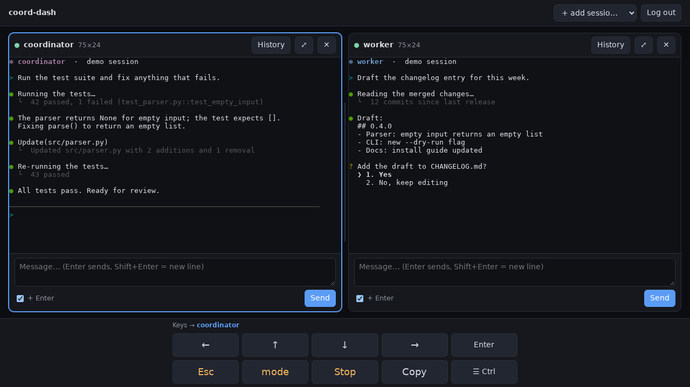
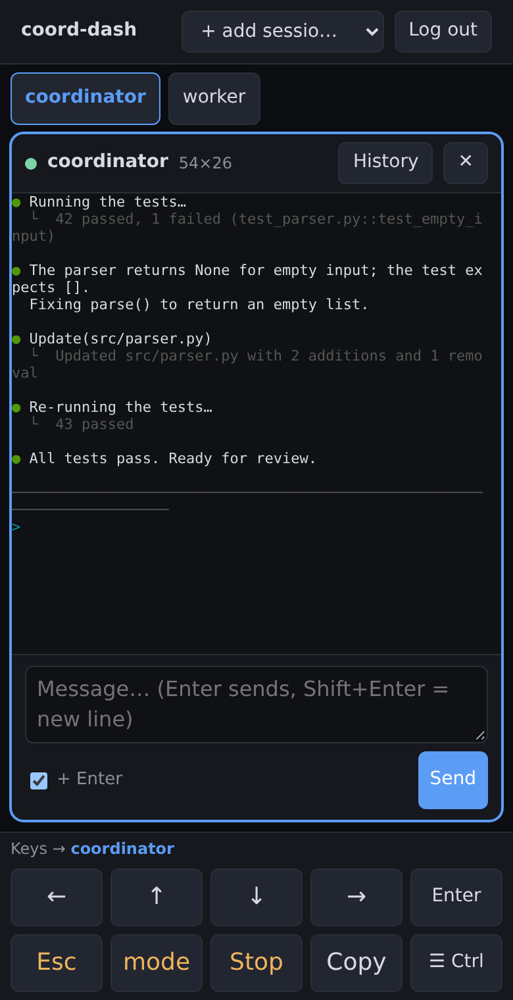

# coord-dash

A small, phone-friendly web dashboard for **Claude Code sessions running in tmux**. Watch several
sessions live, type messages into them, and press the keys Claude Code needs (arrows, Esc,
Shift+Tab, Ctrl shortcuts) from your phone or another computer. No npm dependencies on the
server, one Node process, no tmux client attached.





> coord-dash is an independent open-source project. It is **not affiliated with, endorsed by or
> supported by Anthropic.** "Claude" and "Claude Code" are Anthropic's names for its products.

## Features

- **Live panels:** every tmux session you pick, with its own scrollback (up to 3000 lines) and a
  full-screen **History** view. On a desktop the panels fill the window down to the key bar, as
  many side by side as fit (about 480 px each), the rest in further rows.
- **Resizable:** drag the dividers between panels (side by side and between rows; mouse or touch).
  Double-click or double-tap a divider for equal sizes. Each panel stays at least 20 columns ×
  6 rows. **⤢** maximizes a panel; click it again for the previous sizes. Sizes and the
  maximized panel are remembered per browser (equal sizes if they don't fit the screen).
- **The terminal follows the panel:** each session's tmux window is resized to exactly what fits
  its panel (`resize-window`, with `window-size manual` so tmux keeps it), on load, on every
  resize and when you release a divider. Claude Code redraws for the new size. The label in the
  panel header is the real tmux size. If the same session is open in two browsers, the panel you
  last tapped wins.
- **Phone** (< 600 px): one panel at a time, chosen with tabs at the top; the key bar serves the
  visible panel.
- **Message box per panel:** Enter sends, Shift+Enter adds a line. Multi-line text arrives as one
  bracketed paste, so Claude Code sees one message. Untick "+ Enter" to type without submitting.
- **Key bar** (always at the bottom, never covering a panel):
  ← ↑ ↓ → Enter · Esc · **mode** (Shift+Tab) · **Stop** (Ctrl+C) · **Copy** · **☰ Ctrl**.
  Esc, mode and Stop ask before sending.
- **☰ Ctrl menu**, a bottom sheet that closes after each tap; every item shows its shortcut:
  - *Recent*: your last 3 (per browser)
  - *Run*: Background task (Ctrl+B), Send queued now (Ctrl+X Ctrl+S), Rewind (Esc Esc, confirms),
    Stop subagents (Ctrl+X Ctrl+K twice, confirms)
  - *View*: Transcript (Ctrl+O), Task list (Ctrl+T), History search (Ctrl+R), Redraw (Ctrl+L)
  - *Prompt*: Stash/restore (Ctrl+S), New line (Ctrl+J), Undo edit (Ctrl+_), Delete word (Ctrl+W),
    Clear line (Ctrl+U)
- **Panel targeting:** the key bar and the menu act on the **highlighted panel**, the last one you
  tapped. Its name is shown on the bar (`Keys → name`).
- **Copy:** copies the mouse/touch selection in the targeted panel, or its whole visible screen
  if nothing is selected, and shows "Copied". Uses the browser clipboard only; nothing goes to tmux.
- **Light:** about 60 MB of RAM plus up to about 1 MB of scrollback per watched session. tmux is
  polled (`capture-pane`, 2× per second) only while a browser is watching; background tabs
  disconnect. The only thing coord-dash changes about a window is its size (see above); a tmux
  client you attach yourself sees that size too.

## Requirements

- **Linux or macOS** with **tmux ≥ 3.0** and **Node.js ≥ 22**
- **Claude Code** (or any other program) running in tmux sessions, as the same user that will run
  coord-dash
- **Tailscale** (recommended) or another VPN to reach it from other devices
- systemd for the optional user service (Linux), or launchd (macOS)

## Install

```bash
git clone https://github.com/SiChro/coord-dash.git ~/coord-dash
cd ~/coord-dash
node setup.js
```

`setup.js` asks for a dashboard password (at least 12 characters, stored as an scrypt hash), the
sessions to show by default (`tmux ls` lists them), the listen address (keep `127.0.0.1`), the
port, and optional allowed Tailscale logins. It writes `~/.config/coord-dash/config.json` with
mode 600. There is nothing to `npm install`: xterm.js is vendored in `public/vendor/`.

Try it in the foreground:

```bash
node server.js
```

It prints `coord-dash listening on http://127.0.0.1:7681`. Stop it with Ctrl-C.

## Configuration

All machine-specific values live in the config file, never in the code. The repository contains
[`config.example.json`](config.example.json); your real file stays outside the repo
(`~/.config/coord-dash/config.json`, or the path in `COORD_DASH_CONFIG`). `config.json` is
gitignored in case you keep a copy here.

| Key | Default | Meaning |
| --- | --- | --- |
| `host` | `127.0.0.1` | Listen address. Only loopback (`127.0.0.1`, `::1`, `localhost`) or a Tailscale address is accepted. |
| `port` | `7681` | Listen port |
| `sessions` | `[]` | tmux sessions shown on a browser's first visit |
| `pollMs` | `500` | Snapshot interval per watched session (200–5000) |
| `allowedTailscaleLogins` | `[]` | Optional identity allowlist (needs `tailscale serve`) |
| `tmuxSocket` | `null` | Set this if your sessions use `tmux -S <path>` |
| `secureCookie` | auto | `true` on loopback (behind HTTPS), `false` on a Tailscale IP |
| `passwordHash`, `cookieSecret` | none | Written by `setup.js`. The server won't start without them. |

Re-run `node setup.js` to change values (Enter keeps the current ones). `node setup.js --rotate`
also issues a new cookie secret, which logs out every browser.

## Run it as a systemd user service

The unit file is a template: replace `@NODE@` with your Node binary and `@DIR@` with the
checkout's path.

```bash
mkdir -p ~/.config/systemd/user
sed -e "s|@NODE@|$(command -v node)|" -e "s|@DIR@|$PWD|" coord-dash.service > ~/.config/systemd/user/coord-dash.service
systemctl --user daemon-reload
systemctl --user enable --now coord-dash
systemctl --user status coord-dash --no-pager
```

User services stop when you log out unless lingering is enabled:

```bash
sudo loginctl enable-linger "$USER"
```

If you use nvm, run the `sed` line again after switching Node versions, then `daemon-reload` and
`restart`. The unit runs at low priority with modest limits (`Nice=10`, `MemoryMax=200M`,
`CPUQuota=25%`); adjust them in the installed copy if your machine needs something else.

| What | Command |
| --- | --- |
| Logs | `journalctl --user -u coord-dash -f` |
| Restart (after `git pull` or a config change) | `systemctl --user restart coord-dash` |
| Uninstall | `systemctl --user disable --now coord-dash && rm ~/.config/systemd/user/coord-dash.service` |

### Optional: start your tmux sessions at boot

`scripts/start-sessions.sh` starts the sessions listed in `~/.config/coord-dash/sessions`, one
per line as `name | working directory | command` (see [`sessions.example`](sessions.example)).
Sessions that are already running are left alone. Each session gets a normal shell with the command
typed into it, so quitting Claude Code leaves the shell open instead of closing the session.

```bash
cp sessions.example ~/.config/coord-dash/sessions   # then edit it
sh scripts/start-sessions.sh                        # try it once
sed -e "s|@DIR@|$PWD|" coord-dash-sessions.service > ~/.config/systemd/user/coord-dash-sessions.service
systemctl --user daemon-reload
systemctl --user enable coord-dash-sessions
```

This needs lingering (see above) to run at boot without a login. The tmux server stays in this
unit, so the unit uses `KillMode=process`: stopping or restarting it does not kill your sessions.
`systemctl --user kill coord-dash-sessions` would, so don't use that.

## Run it on macOS (launchd)

[`coord-dash.plist`](coord-dash.plist) is a launchd agent that runs coord-dash while you are logged
in. Its `PATH` must contain `tmux` (Homebrew puts it in `/opt/homebrew/bin` or `/usr/local/bin`).

```bash
mkdir -p ~/Library/LaunchAgents
sed -e "s|@NODE@|$(command -v node)|" -e "s|@DIR@|$PWD|" -e "s|@HOME@|$HOME|" \
    -e "s|@PATH@|$(dirname "$(command -v tmux)"):/usr/bin:/bin|" coord-dash.plist > ~/Library/LaunchAgents/coord-dash.plist
launchctl bootstrap "gui/$(id -u)" ~/Library/LaunchAgents/coord-dash.plist
```

| What | Command |
| --- | --- |
| Logs | `tail -f ~/Library/Logs/coord-dash.log` |
| Restart | `launchctl kickstart -k "gui/$(id -u)/coord-dash"` |
| Uninstall | `launchctl bootout "gui/$(id -u)/coord-dash" && rm ~/Library/LaunchAgents/coord-dash.plist` |

## Reach it from your phone (Tailscale)

`tailscale serve` adds HTTPS and keeps coord-dash reachable **only inside your tailnet**. Check
what it already serves first, so you don't overwrite anything:

```bash
tailscale serve status
sudo tailscale serve --bg --https=8443 http://127.0.0.1:7681
tailscale serve status
```

The last command prints the URL, for example `https://<machine>.<tailnet>.ts.net:8443/`. If HTTPS
isn't enabled, turn on MagicDNS and HTTPS certificates in the Tailscale admin console. To stop:
`sudo tailscale serve --https=8443 off`.

**Use `tailscale serve`, never `tailscale funnel`**: funnel publishes to the public internet.

Optional: allow only your Tailscale identity. After one login, `journalctl --user -u coord-dash |
grep 'login ok'` shows it; enter it in `setup.js` under allowed Tailscale logins and restart.

Without `tailscale serve`, you can set `host` to the machine's Tailscale IP (`tailscale ip -4`) and
open `http://100.x.y.z:7681`. WireGuard still encrypts the traffic, but the cookie isn't marked
`Secure` and identity checks aren't available (don't combine this with `allowedTailscaleLogins`).

## Security

**Never expose coord-dash to the internet.** Every panel is a live shell, often running an agent
with broad permissions. Reach it only through Tailscale or another VPN.

Defaults and layers:

1. **Localhost only by default.** The server refuses to start unless `host` is `127.0.0.1`, `::1`,
   `localhost` or a Tailscale address (100.64.0.0/10, fd7a:115c:a1e0::/48). It never binds 0.0.0.0.
2. **Login always required.** No password hash in the config, no start. The password is stored as
   an scrypt hash. Sessions use an HMAC-signed, `HttpOnly`, `SameSite=Strict` cookie (`Secure`
   behind HTTPS), valid for 30 days. 10 failed logins in 10 minutes block logins for 10 minutes;
   every failure is delayed by 1 second.
3. **Optional Tailscale identity check** (`allowedTailscaleLogins`), applied before the password.
4. **CSRF/XSS:** state-changing requests must be same-origin JSON with a custom header. A strict CSP
   allows only same-origin scripts and blocks framing. Terminal output is drawn by xterm.js, never
   inserted as HTML.
5. **Constrained input:** tmux runs via `execFile` (no shell). Session names must match
   `[A-Za-z0-9_-]`. Only allow-listed keys can be sent (`KEYS` in `server.js`; Ctrl+D and Ctrl+Z
   are deliberately absent). Control characters are stripped from typed text. Logs record the
   length of each message, never its content.
6. **Config file must be mode 600**, or the server refuses to start.

Anyone who can run processes as your user can already control tmux; coord-dash adds a
loopback port that needs the password. Report security problems privately to the maintainer
(GitHub security advisory on this repository), not in a public issue.

## Development and tests

```bash
npm test               # key allow-list, copy logic, font fitting, terminal size/limit/layout logic,
                       # start-sessions.sh against a fake tmux (no dependencies)
npm run test:browser   # real server + isolated tmux server + headless Chromium
node scripts/screenshots.mjs   # regenerate docs/screenshot-*.png from neutral demo sessions
```

The browser test starts the server on port 7699 against its own tmux server. Each pane runs
`test/fixtures/tui.cjs`, which (like Claude Code) redraws a screen full of tokens like `r021c04`
for the window size on every resize. It checks, at 1280 px and 375 px: the panels fill the area,
the key bar has its own space, every message box is uncovered and above it, panels don't overlap,
a mouse selection copies exactly the dragged token (also after scrolling the scrollback and after a
resize), and Copy without a selection copies the visible screen. At 2560 px with three panels:
each terminal is wider than 80 columns, tmux has exactly the panel's size, and the screen is
redrawn without wrapping; dragging a divider resizes tmux while dragging and on release, stops at
20 columns, double-click resets; maximize and restore; the layout survives a reload. Stacked at
900 px: touch drag and double-tap on the row divider. Phone: tabs, one panel at a time. Scrolling:
a scroll the user didn't make (a resize or font change moves the viewport) never stops a panel
following the live screen, while a wheel scroll up survives a resize until **Live** is pressed.
Not covered: iOS keyboard behaviour.

It needs `playwright-core` and a Chromium, which are not dependencies of the project. The simplest
setup is `npm i --no-save playwright-core && npx playwright-core install chromium`; the test then
imports `playwright-core` and uses Playwright's own browser. For anything else, copy `test/browser.config.example.json` to
`test/browser.config.json` (gitignored) and set the paths there, or use the environment variables
`PW_CORE`, `CHROME`, `CHROME_LIB_DIR`, `FONTCONFIG_FILE`, `TEST_PORT`.

`test/docker-demo.sh` runs a throwaway demo in Docker (Debian + Node 22 + tmux, fake sessions) on
`http://localhost:8099` with the password `test-password-123`.

## Contributing

Issues and pull requests are welcome. Please read [CONTRIBUTING.md](CONTRIBUTING.md) first:
contributions require agreeing to a short contributor license agreement.

## License

Copyright (C) 2026 Simon Chromec.

coord-dash is free software under the **GNU Affero General Public License v3.0 only**
([LICENSE](LICENSE), SPDX `AGPL-3.0-only`). If you run a modified version as a network service,
the AGPL requires you to offer its source code to the users of that service.

**Commercial licenses** (for use without the AGPL's obligations) are available on request: open an
issue titled "Commercial license" or contact the maintainer through GitHub.

Third-party code: [xterm.js](https://github.com/xtermjs/xterm.js) and its unicode11 addon, vendored
in `public/vendor/`, are under the MIT license (see the `LICENSE-*.txt` files there).

coord-dash is not affiliated with Anthropic.
